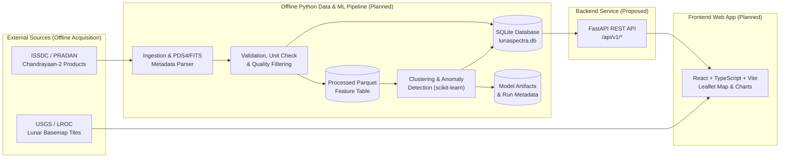
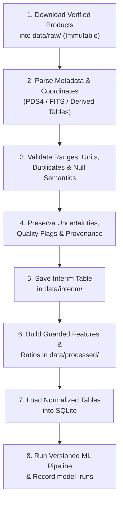
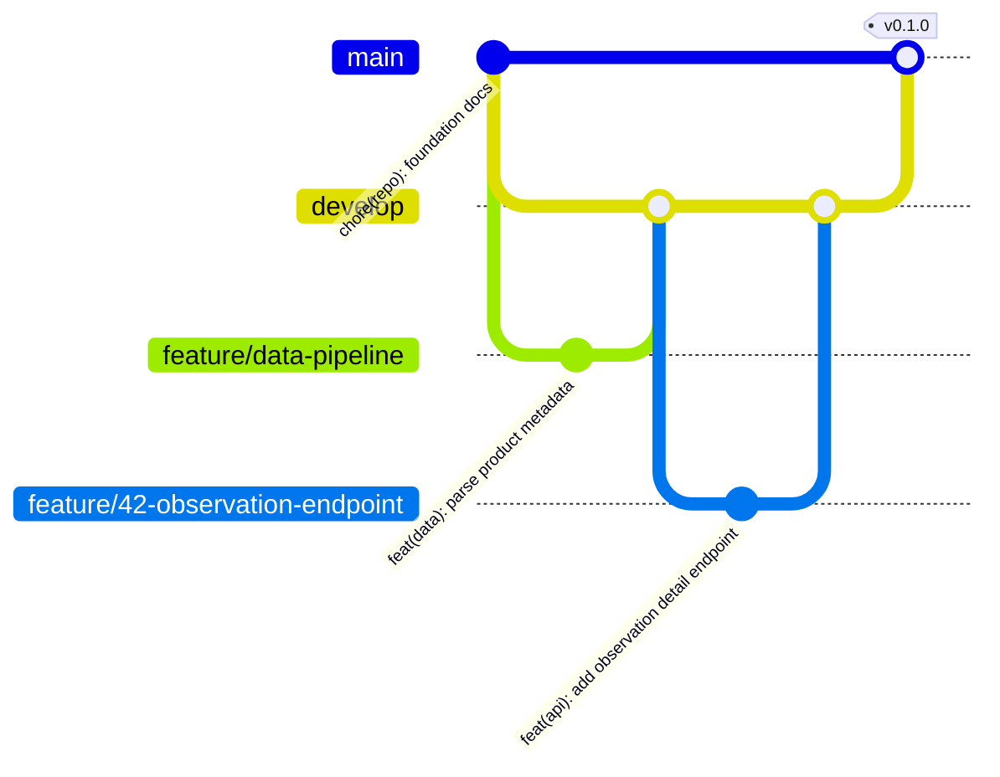

<div align="center">

# LunaSpectra

<p><strong><em>Explore the Moon through data.</em></strong></p>

**LunaSpectra: Intelligent Analysis and Interactive Mapping of Lunar Elemental Composition Using Chandrayaan-2 Data**


*Academic Mini-Project (2 Credits, Third-Year Computer Science and Engineering — 4-Student Team)*

</div>

---

> [!NOTE]
> **Project Phase Notice (Phase 1 Implemented):** LunaSpectra is in **Active Development**. The **Phase 1 backend vertical slice**—genuine Chandrayaan-2 CLASS data ingestion (`DOI: 10.17632/6mmd96j5bg.1`), normalized Parquet generation, SQLite database (`backend/lunaspectra.db`), FastAPI REST endpoints under `/api/v1`, and backend automated tests—is **Implemented**. Machine-learning pipelines, geolocated lunar mapping, and the React frontend remain **Planned**. Because the active Phase 1 dataset does not include latitude/longitude coordinates, `/api/v1/map/availability` truthfully reports `available: false`.

---

## Table of Contents

1. [Executive Overview](#1-executive-overview)
2. [Problem Statement](#2-problem-statement)
3. [Motivation](#3-motivation)
4. [Proposed Solution](#4-proposed-solution)
5. [Project Objectives](#5-project-objectives)
6. [Scope](#6-scope)
7. [Non-Goals and Scientific Honesty](#7-non-goals-and-scientific-honesty)
8. [Scientific Background: X-Ray Fluorescence, CLASS, and XSM](#8-scientific-background-x-ray-fluorescence-class-and-xsm)
9. [Core Proposed Features](#9-core-proposed-features)
10. [Proposed System Architecture](#10-proposed-system-architecture)
11. [Proposed Data Pipeline](#11-proposed-data-pipeline)
12. [Proposed Machine-Learning Methodology](#12-proposed-machine-learning-methodology)
13. [Planned Application Pages & Mockup Placeholders](#13-planned-application-pages--mockup-placeholders)
14. [Proposed Technology Stack](#14-proposed-technology-stack)
15. [Repository Structure](#15-repository-structure)
16. [Dataset Strategy](#16-dataset-strategy)
17. [Proposed API Overview](#17-proposed-api-overview)
18. [Preliminary Getting Started](#18-preliminary-getting-started)
19. [Environment Variables Overview](#19-environment-variables-overview)
20. [Team Structure](#20-team-structure)
21. [Branching Workflow](#21-branching-workflow)
22. [Planned Testing Strategy](#22-planned-testing-strategy)
23. [Roadmap](#23-roadmap)
24. [Risks and Limitations](#24-risks-and-limitations)
25. [Sustainable Development Goals (SDG) Alignment](#25-sustainable-development-goals-sdg-alignment)
26. [Data Rights, Licensing, and Acknowledgements](#26-data-rights-and-licensing)
27. [Contributing](#27-contributing)
28. [References](#28-references)
29. [Contact & Academic Metadata](#29-contact--academic-metadata)

---

## 1. Executive Overview

**LunaSpectra** is a planned scientific data-analytics and interactive geospatial visualization platform designed to explore lunar surface elemental composition associated with **Chandrayaan-2** observations. Developed as a 2-credit, third-year Computer Science and Engineering mini-project by a four-student team, the project focuses on reproducible planetary data engineering, interpretable unsupervised machine learning, quality-aware anomaly detection, and interactive 2D lunar mapping.

Rather than treating planetary science archives as opaque tables or making unsupported geological claims, LunaSpectra emphasizes **provenance, measurement uncertainty, quality flags, footprint geometry, and transparent methodology**. Processed observations will be exposed through a proposed **FastAPI** backend and explored through a separate **React + TypeScript** web interface.

For full project governance and design documents, see [docs/PROJECT_PROPOSAL.md](docs/PROJECT_PROPOSAL.md) and [docs/SYSTEM_ARCHITECTURE.md](docs/SYSTEM_ARCHITECTURE.md).

---

## 2. Problem Statement

Publicly archived planetary science datasets—such as those from ISRO's Chandrayaan-2 mission at the Indian Space Science Data Centre (ISSDC)—contain rich spatial and compositional measurements, yet exploring them effectively poses practical challenges for students, researchers, and data analysts:

- **Format and accessibility barriers:** Archive bundles often use domain-specific formats (PDS4 XML labels, FITS files, tabular derivatives) with intricate metadata and coordinate conventions.
- **Disconnected analytical workflows:** Scripts for cleaning data, inspecting measurement uncertainties, running clustering/anomaly algorithms, and plotting footprints on a lunar map rarely live in an integrated, reproducible pipeline.
- **Loss of scientific context:** Generic dashboards often strip away observation footprint geometry, solar-excitation context, quality flags, and measurement uncertainty—risking misinterpretation of noisy or uncalibrated points.

See [docs/PROBLEM_STATEMENT.md](docs/PROBLEM_STATEMENT.md) for the complete problem analysis.

---

## 3. Motivation

- **Educational Bridge:** Applying software engineering, data pipelines, and unsupervised ML to authentic Indian space-science data from Chandrayaan-2 provides rigorous, multidisciplinary training.
- **Reproducible Planetary Analytics:** Establishing strict schemas, unit validation, and synthetic-vs-real data isolation demonstrates responsible scientific software engineering.
- **Accessible Exploration:** An interactive 2D lunar map paired with composition charts and region-comparison tools lowers the barrier to inspecting spatial elemental patterns without misrepresenting observation coverage.

---

## 4. Proposed Solution

LunaSpectra proposes a modular two-tier analytical platform:

1. **Offline Data & ML Pipeline (Python):** Acquires verified Chandrayaan-2 elemental-composition products (Approach A MVP), validates coordinates, units, quality flags, and uncertainties, builds a normalized Parquet feature table and SQLite analytical database, and runs reproducible clustering and anomaly-detection experiments tracked via `model_runs`.
2. **Backend Service (FastAPI — Proposed):** Serves validated observations, GeoJSON footprints, dataset summaries, cluster/anomaly overlays, region comparisons, and export payloads over versioned REST endpoints.
3. **Frontend Explorer (React + TypeScript — Planned):** Provides a 2D lunar basemap (Leaflet), elemental layer controls, observation inspection panels, side-by-side region comparison, and explicit uncertainty/provenance indicators.

---

## 5. Project Objectives

1. Design a reproducible ingestion and validation workflow for Chandrayaan-2 elemental-composition products (pending PDS4 product verification in Phase 2).
2. Preserve full scientific metadata: observation coordinates, footprint geometry, uncertainties, quality flags, product versions, and provenance URIs.
3. Compute scientifically justified elemental ratios (e.g., Mg/Si, Al/Si, Fe/Si) with strict denominator and compatibility checks.
4. Apply baseline unsupervised clustering (K-Means, optional DBSCAN comparison) and quality-aware anomaly detection (Z-score, MAD, Isolation Forest, optional LOF comparison).
5. Build an interactive 2D lunar explorer and region-comparison interface backed by a clean REST API contract.
6. Maintain strict separation between synthetic development fixtures and mission observations.

---

## 6. Scope

**MVP Scope (2-Credit Deliverable):**

- Reproducible data-ingestion and validation pipeline
- Analysis-ready geolocated elemental feature table (Parquet + SQLite)
- Dataset summary statistics and quality metrics
- Composition-based clustering and quality-aware anomaly detection
- Interactive 2D lunar map showing actual observation points or footprints
- Elemental layer selection, cluster overlay, and anomaly overlay
- Observation-detail inspector and two-region comparison tool
- Composition charts, provenance, uncertainty, and quality metadata
- Separate FastAPI backend and React/TypeScript frontend with basic automated tests

**Optional Extensions (Out of MVP Scope — Future Work Only):**

- Raw CLASS and XSM joint spectral analysis and spectral peak fitting
- Advanced uncertainty propagation
- 3D lunar globe using CesiumJS
- PostgreSQL/PostGIS spatial queries and external geological-unit overlays
- User accounts, saved analyses, exportable formatted reports, or additional Chandrayaan-2 instruments
- Explainable cluster-characterization tools

---

## 7. Non-Goals and Scientific Honesty

LunaSpectra explicitly commits to the following boundaries:

- **Not a mineral-discovery engine:** LunaSpectra does **not** claim to discover new minerals.
- **Not an image-classification or real-time telemetry system:** It is neither a lunar image-classification project nor a real-time satellite-monitoring system.
- **Clusters are mathematical groupings:** An ML cluster is **not** automatically a geological formation, mineral class, or rock type.
- **Anomalies require cautious review:** An anomaly is **not** automatically a valuable resource or scientific discovery; it may reflect unusual composition, measurement noise, poor signal-to-noise ratio, calibration issues, missing solar context, or a processing error.
- **Peak intensity is not abundance:** X-ray peak intensity is not automatically elemental weight percentage; accurate abundance estimation from raw observations requires calibration, background correction, solar-spectrum information, response matrices, spectral fitting, and physical modelling.
- **Raw spectral processing is an optional extension:** The preferred MVP uses processed or derived geolocated elemental-abundance products once verified from downloaded PDS4 bundles and official documentation.
- **No implied global interpolation:** The map displays measured observation points or footprints and must never imply continuous coverage across unmeasured lunar pixels.
- **Strict synthetic separation:** Synthetic data used during early development must remain visibly and technically tagged (`data_origin = "synthetic"`) and separated from mission data.
- **No invented metrics:** No accuracy percentages, latency figures, dataset sizes, observation counts, or test counts are fabricated prior to verification.

See [docs/ETHICS_AND_LIMITATIONS.md](docs/ETHICS_AND_LIMITATIONS.md) for full details.

---

## 8. Scientific Background: X-Ray Fluorescence, CLASS, and XSM

Lunar surface elemental remote sensing on Chandrayaan-2 relies on **X-ray Fluorescence (XRF)** measured jointly by two orbiter payloads:

1. **Solar Emission:** The Sun emits X-rays (particularly during solar flares and active coronal states) across the soft X-ray band.
2. **Surface Excitation:** Incoming solar X-rays strike the lunar regolith and excite inner-shell electrons of surface atoms.
3. **Characteristic Fluorescence:** As excited atoms relax, elements emit characteristic secondary fluorescent X-rays at element-specific energies (for example, lines associated with Mg, Al, Si, Ca, Ti, and Fe).
4. **CLASS Measurement:** The **Chandrayaan-2 Large Area Soft X-ray Spectrometer (CLASS)**—an array of Swept Charge Devices with gold-coated copper collimators—records the resulting lunar X-ray spectra over defined orbital footprints.
5. **XSM Measurement:** The **Solar X-ray Monitor (XSM)** simultaneously measures the incoming solar X-ray spectrum (1–15 keV) at high cadence, providing the incident excitation reference required for quantitative spectral interpretation.
6. **Scientific Processing:** Combining calibrated CLASS spectra, XSM solar spectra, instrument response matrices, and geometric/viewing corrections enables scientists to investigate surface elemental abundances.

See [docs/DATASET_GUIDE.md](docs/DATASET_GUIDE.md) for how LunaSpectra maps these concepts into Approach A (MVP) vs. Approach B (Optional Extension).

---

## 9. Core Proposed Features

- **Geolocated Lunar Explorer:** Interactive 2D lunar basemap displaying measured observation coordinates or footprint polygons with layer toggles.
- **Elemental & Ratio Views:** Inspect Mg, Al, Si, Ca, and Fe abundances (subject to verification in selected products) plus guarded ratios (`Mg/Si`, `Al/Si`, `Fe/Si`).
- **ML Cluster & Anomaly Overlays:** Filter and inspect K-Means/DBSCAN cluster assignments and Isolation Forest / statistical anomaly scores alongside quality indicators.
- **Observation Inspector:** Detailed provenance card showing `source_product_id`, acquisition window, footprint geometry, per-element uncertainties, and quality flags.
- **Two-Region Comparison:** Side-by-side compositional bar charts, ratio comparisons, numerical difference tables, and automatic quality/uncertainty warnings.
- **Methodology & Provenance Views:** Transparent documentation of preprocessing, feature scaling, model-run parameters, and dataset licensing right inside the application.

---

## 10. Proposed System Architecture

> Status: **Proposed** (no application services implemented yet).



See [docs/SYSTEM_ARCHITECTURE.md](docs/SYSTEM_ARCHITECTURE.md) for component boundaries, sequence diagrams, and request lifecycles.

---

## 11. Proposed Data Pipeline

> Status: **Proposed**.



Detailed rules are specified in [docs/DATA_PIPELINE.md](docs/DATA_PIPELINE.md) and [docs/DATA_DICTIONARY.md](docs/DATA_DICTIONARY.md).

---

## 12. Proposed Machine-Learning Methodology

- **Preprocessing:** Duplicate check, coordinate-range validation, missing-value analysis, unit verification, quality-flag filtering, uncertainty preservation, explicit feature selection, and `StandardScaler` / `RobustScaler`.
- **Clustering:** **K-Means** as the interpretable baseline, **DBSCAN** as an optional density-based comparison, **PCA** for 2D projection, evaluated via Silhouette score, Davies–Bouldin index, and cross-seed/preprocessing stability.
- **Anomaly Detection:** **Z-score** and **Median Absolute Deviation (MAD)** as statistical baselines; **Isolation Forest** as the primary multivariate method; **Local Outlier Factor (LOF)** as an optional comparison; tested with controlled synthetic anomaly injections and interpreted only after quality-flag screening.
- **Guarded Ratios:** `Mg/Si`, `Al/Si`, and `Fe/Si` calculated strictly when denominators are positive, non-null, and scientifically compatible.

See [docs/ML_METHODOLOGY.md](docs/ML_METHODOLOGY.md).

---

## 13. Planned Application Pages & Mockup Placeholders

| Page (Planned) | Primary Purpose |
| --- | --- |
| **Landing Page** | Project introduction, dataset overview, XRF scientific explanation, and link to Explorer |
| **Dashboard** | Dataset summary, observation count, spatial coverage summary, available elements, quality stats, model-run metadata |
| **Lunar Explorer** | Interactive 2D lunar basemap, element selector, cluster & anomaly overlays, quality filter, legend, coordinate readout |
| **Observation Details** | Source product ID, acquisition time, coordinates, footprint geometry, element values, uncertainties, quality status, provenance |
| **Region Comparison** | Two-observation or two-region selector, side-by-side composition charts, ratio differences, quality/uncertainty warnings |
| **Analysis & Methodology** | Preprocessing, features, clustering, anomaly detection, evaluation metrics, scientific limitations |
| **Data & Sources** | Dataset origin, product version, ISRO/ISSDC attribution, usage conditions, data dictionary |

### UI Mockup Placeholders

> [!IMPORTANT]
> No frontend UI exists yet. The slots below are reserved for future wireframe mockups (and must remain explicitly labelled **Mockup** until real application screenshots are produced).

- **Mockup Placeholder 1 — Lunar Explorer Map View:** `[Reserved: assets/images/mockup_lunar_explorer.png — Not yet created]`
- **Mockup Placeholder 2 — Observation Detail & Composition Panel:** `[Reserved: assets/images/mockup_observation_detail.png — Not yet created]`
- **Mockup Placeholder 3 — Region Comparison View:** `[Reserved: assets/images/mockup_region_comparison.png — Not yet created]`

See [docs/FRONTEND_SPECIFICATION.md](docs/FRONTEND_SPECIFICATION.md) for component design and state handling.

---

## 14. Proposed Technology Stack

| Layer | Selected / Proposed Technologies |
| --- | --- |
| **Frontend** | React, TypeScript, Vite, Tailwind CSS, React Leaflet & Leaflet, Plotly.js or Recharts, TanStack Query, Zod |
| **Frontend Quality** | Vitest, React Testing Library, ESLint, Prettier |
| **Backend** | Python 3.11+, FastAPI, Uvicorn, Pydantic, SQLAlchemy, Alembic |
| **Data & ML** | Pandas, NumPy, SciPy, Scikit-learn, Astropy (FITS if required), PyArrow (Parquet), Shapely (footprint geometry if required) |
| **Backend Quality** | Pytest, Ruff, Mypy |
| **Storage** | Immutable local `data/raw/`, Apache Parquet (processed feature tables), SQLite (initial app DB), JSON/GeoJSON, local `models/` (PostgreSQL/PostGIS optional future scaling only) |
| **Workflow & CI** | Git, GitHub, Conventional Commits, GitHub Issues & Projects, Pull Requests, GitHub Actions (planned CI), Pre-commit hooks, Docker (optional later) |

---

## 15. Repository Structure

```text
lunaspectra/
├── frontend/                   # Planned React + TypeScript application
│   └── .gitkeep
├── backend/                    # Planned FastAPI service & database models
│   └── .gitkeep
├── data/
│   ├── raw/                    # Ignored: immutable downloaded Chandrayaan-2 products
│   ├── interim/                # Ignored: intermediate cleaned artifacts
│   ├── processed/              # Ignored: large Parquet analytical tables
│   └── sample/                 # Committed small synthetic/schema sample fixtures
├── notebooks/                  # Exploratory analysis notebooks (planned)
├── models/                     # Ignored: serialized model binaries
├── scripts/                    # Planned CLI ingestion/ML runner scripts
├── tests/                      # Planned automated test suites
├── docs/                       # Architecture, dataset, ML, API, and governance docs
├── assets/
│   ├── images/                 # Mockups and visual assets
│   └── diagrams/               # Exported diagrams if needed
├── .github/
│   ├── ISSUE_TEMPLATE/         # Structured issue forms
│   └── pull_request_template.md
├── .env.example                # Safe environment variable template
├── .gitattributes              # Line-ending and binary rules
├── .gitignore                  # Protects secrets, raw data, binaries, build outputs
├── CODE_OF_CONDUCT.md
├── CONTRIBUTING.md
├── LICENSE                     # MIT License for student-authored code
├── SECURITY.md
└── README.md
```

---

## 16. Dataset Strategy & Phase 1 Real Dataset

LunaSpectra separates dataset acquisition into two clearly bounded tiers:

- **Phase 1 Active Dataset (`CLASS_CHANDRAYAAN2`, DOI: `10.17632/6mmd96j5bg.1`):** Genuine Chandrayaan-2 CLASS lunar X-ray data (Shyama Narendranath, ISRO, CC BY 4.0) covering **two observation dates** (`2019-11-18` and `2020-05-29`). It includes CLASS source and background spectra (`1024`-channel FITS & ASCII), onboard Fe-55 calibration spectra, **XSM solar X-ray data** (`CH2_XSM_20191118_90853504_90853624.pha` + Chianti solar model), XSPEC modelled line fluxes (`O, Na, Mg, Al, Si` for `2019-11-18`; `O, Mg, Al, Si, Ca-Ka, Ca-Kb, Fe` for `2020-05-29`), and X2ABUNDANCE weight-percent abundances (`Mg, Al, Si, Ca` with asymmetric upper/lower uncertainties for `2020-05-29`; `181120/R2_abundance.txt` element alignment is withheld due to a 5-label vs. 4-value mismatch). **Geospatial coordinates and footprints are absent**, so lunar mapping is marked unavailable (`available: false`) and complete lunar coverage is not claimed. The active backend serves **genuine mission data** (`data_origin = "mission"`), not synthetic data.
- **Approach A (Phase 2+ Geolocated Expansion):** Ingest geolocated elemental-abundance products from ISSDC/PRADAN PDS4 archives once verified.
- **Approach B (Optional Future Extension):** Full raw CLASS + XSM joint spectral fitting and physical abundance inversion.

See [docs/REAL_DATA_INVENTORY.md](docs/REAL_DATA_INVENTORY.md), [docs/REAL_DATA_FIELD_MAPPING.md](docs/REAL_DATA_FIELD_MAPPING.md), and [docs/DATASET_GUIDE.md](docs/DATASET_GUIDE.md).

---

## 17. API Overview (`/api/v1`)

Phase 1 real-data endpoints are **Implemented**; geospatial map, clustering, anomaly, comparison, and export endpoints remain **Proposed** (see [docs/API_SPECIFICATION.md](docs/API_SPECIFICATION.md)):

| Method | Route | Status | Purpose |
| --- | --- | --- | --- |
| `GET` | `/api/v1/health` | **Implemented (Phase 1)** | Service, DB readiness, active dataset & counts |
| `GET` | `/api/v1/datasets` | **Implemented (Phase 1)** | List registered real datasets and provenance |
| `GET` | `/api/v1/datasets/{dataset_id}` | **Implemented (Phase 1)** | Retrieve dataset metadata & content types |
| `GET` | `/api/v1/dataset/summary` | **Implemented (Phase 1)** | Measurable counts, elements, dates, missing-field summary |
| `GET` | `/api/v1/elements` | **Implemented (Phase 1)** | Available elements, units, and uncertainty availability |
| `GET` | `/api/v1/observations` | **Implemented (Phase 1)** | Paginated, filterable & sortable observations |
| `GET` | `/api/v1/observations/{observation_id}` | **Implemented (Phase 1)** | Metadata, provenance, spectra, fluxes, abundances, missing fields |
| `GET` | `/api/v1/observations/{observation_id}/spectra` | **Implemented (Phase 1)** | Source/background/XSM arrays with optional downsampling |
| `GET` | `/api/v1/observations/{observation_id}/abundances` | **Implemented (Phase 1)** | Elemental abundances (`wt%`) and asymmetric uncertainties |
| `GET` | `/api/v1/observations/{observation_id}/line-fluxes` | **Implemented (Phase 1)** | Modelled X-ray line fluxes (`photons/cm2/s`) |
| `GET` | `/api/v1/map/availability` | **Implemented (Phase 1)** | Honest coordinate/footprint availability (`available: false` in Phase 1) |
| `GET` | `/api/v1/map/observations` | Proposed (Phase 2+) | GeoJSON `FeatureCollection` once geolocated products exist |
| `GET` | `/api/v1/clusters` | Proposed (Phase 4+) | Cluster assignments & summary stats by `model_run_id` |
| `GET` | `/api/v1/anomalies` | Proposed (Phase 4+) | Ranked/filtered anomalies by `model_run_id` |
| `GET` | `/api/v1/model-runs` | Proposed (Phase 4+) | List recorded ML model runs & parameters |
| `GET` | `/api/v1/model-runs/{model_run_id}` | Proposed (Phase 4+) | Inspect configuration and metrics of a run |
| `POST` | `/api/v1/regions/compare` | Proposed (Phase 3+) | Compare two selected observations or bounding boxes |
| `POST` | `/api/v1/exports` | Proposed (Phase 3+) | Request structured JSON/CSV/GeoJSON export metadata |

---

## 18. Getting Started (Backend Implemented; Frontend Planned)

The **Phase 1 backend and real-data pipeline** are runnable from the repository root in Windows PowerShell (see [backend/README.md](backend/README.md)). The React frontend under `frontend/` is **not** initialized yet.

```powershell
# 1. Clone and enter the repository
git clone https://github.com/smruthi006/LunaSpectra.git
cd LunaSpectra

# 2. Optional: create .env from .env.example
Copy-Item .env.example .env

# 3. Backend Setup & Phase 1 Real-Data Pipeline
python -m venv .venv
.\.venv\Scripts\Activate.ps1
python -m pip install --upgrade pip
pip install -r backend\requirements-dev.txt

python backend\scripts\acquire_class_data.py
python backend\scripts\inspect_class_data.py
python backend\scripts\process_class_data.py
python backend\scripts\seed_database.py
uvicorn backend.app.main:app --reload

# 4. Planned Frontend Setup (Not initialized yet)
# cd frontend && npm install && npm run dev
```

See [docs/DEPLOYMENT_GUIDE.md](docs/DEPLOYMENT_GUIDE.md) for environment details.

---

## 19. Environment Variables Overview

Safe defaults are templated in [.env.example](.env.example). Never commit `.env` or add real credentials.

| Variable | Example Value | Purpose |
| --- | --- | --- |
| `APP_ENV` | `development` | Runtime environment identifier |
| `APP_NAME` | `LunaSpectra` | Application display name |
| `API_VERSION` | `v1` | REST API version prefix |
| `API_HOST` / `API_PORT` | `127.0.0.1` / `8000` | Planned FastAPI bind address |
| `FRONTEND_URL` | `http://localhost:5173` | Allowed CORS origin for Vite dev server |
| `DATABASE_URL` | `sqlite:///./backend/lunaspectra.db` | SQLAlchemy connection string |
| `DATA_RAW_DIR` | `./data/raw` | Immutable raw mission archive directory |
| `DATA_INTERIM_DIR` | `./data/interim` | Intermediate cleaned datasets |
| `DATA_PROCESSED_DIR` | `./data/processed` | Processed Parquet feature tables |
| `MODEL_DIR` | `./models` | Local model artifact storage |
| `LOG_LEVEL` | `INFO` | Application logging level |
| `VITE_API_BASE_URL` | `http://localhost:8000/api/v1` | Frontend API base URL |

---

## 20. Team Structure

| Role | Primary Ownership | Member Placeholder |
| --- | --- | --- |
| **Member 1** | Data acquisition, PDS4/FITS parsing, and preprocessing | `[Member 1 Name Placeholder]` (`[Student ID]`) |
| **Member 2** | Machine learning, evaluation, and scientific analysis | `[Member 2 Name Placeholder]` (`[Student ID]`) |
| **Member 3** | Frontend, interactive lunar mapping, and visualization | `[Member 3 Name Placeholder]` (`[Student ID]`) |
| **Member 4** | Backend, database design, integration, and repo maintenance | `[Member 4 Name Placeholder]` (`[Student ID]`) |

---

## 21. Branching Workflow



- Protect `main` and `develop`; merge via pull requests with at least one teammate review.
- Follow Conventional Commits (see [CONTRIBUTING.md](CONTRIBUTING.md) and [docs/TEAM_WORKFLOW.md](docs/TEAM_WORKFLOW.md)).

---

## 22. Planned Testing Strategy

Automated testing will cover data integrity, ML determinism, API contracts, and UI states once implementation begins:

- **Data & Pipeline Tests:** PDS4/FITS metadata parsing, coordinate bounds, longitude convention normalization, unit consistency, duplicate detection, footprint validity, division-by-zero guards, synthetic/real separation.
- **ML Tests:** Deterministic runs across fixed seeds, synthetic anomaly-injection checks, silhouette/stability smoke tests.
- **Backend API Tests:** Pydantic schema validation, pagination, GeoJSON `FeatureCollection` validity, error responses.
- **Frontend Tests:** API contract validation (Zod), map layer controls, empty/error states, accessibility, end-to-end observation selection.

See [docs/TESTING_STRATEGY.md](docs/TESTING_STRATEGY.md).

---

## 23. Roadmap

- [x] **Phase 0 — Feasibility and documentation** *(Completed)*
- [x] **Phase 1 — Real CLASS data ingestion, database foundation, and FastAPI backend** *(Implemented in `feature/real-data-backend`)*
- [ ] **Phase 2 — Geolocated ISSDC/PRADAN dataset expansion**
- [ ] **Phase 3 — Extended backend contracts (GeoJSON map & region comparison)**
- [ ] **Phase 4 — ML baselines (clustering & quality-aware anomaly detection)**
- [ ] **Phase 5 — Frontend and 2D lunar map**
- [ ] **Phase 6 — Integration and end-to-end testing**
- [ ] **Phase 7 — Documentation, demonstration, and final submission**
- [ ] **Phase 8 — Optional extensions** *(Post-MVP only)*

See [docs/ROADMAP.md](docs/ROADMAP.md) for deliverables, dependencies, acceptance criteria, and owners.

---

## 24. Risks and Limitations

Key technical and scientific risks—including absence of a directly usable abundance table, sparse spatial coverage, missing uncertainties, projection mismatches, accidental mixing of synthetic/mission data, and scope creep beyond 2 credits—are tracked with likelihood, impact, and mitigations in [docs/RISK_REGISTER.md](docs/RISK_REGISTER.md).

---

## 25. Sustainable Development Goals (SDG) Alignment

| SDG Alignment | Goal | Relevance to LunaSpectra |
| --- | --- | --- |
| **Primary** | **SDG 9 — Industry, Innovation and Infrastructure** | Builds open, reproducible geospatial analytics infrastructure and scientific software tooling for planetary datasets. |
| **Secondary** | **SDG 4 — Quality Education** | Provides an accessible, scientifically honest learning platform for exploring planetary XRF data and spatial data science. |
| **Supporting** | **SDG 17 — Partnerships for the Goals** | Encourages transparent attribution and responsible reuse of open national space-science archives (ISRO/ISSDC, NASA/USGS). |

---

## 26. Data Rights, Licensing, and Acknowledgements

Rights across software, mission data, basemaps, and dependencies are strictly separated:

1. **Student-Authored Source Code:** Licensed under the [MIT License](LICENSE).
2. **Chandrayaan-2 / ISRO Data:** Governed by ISRO / ISSDC data policy. **The MIT License does not relicense ISRO data.** Raw Chandrayaan-2 products are excluded from this repository.
3. **Lunar Basemap Imagery:** Governed by the respective provider's terms (e.g., USGS Astrogeology / NASA / LROC public domain and attribution guidelines).
4. **Third-Party Libraries:** Governed by their respective open-source licenses.

> **Required Mission Data Acknowledgement:**
> "We acknowledge the use of data from the Chandrayaan-II, second lunar mission of the Indian Space Research Organisation (ISRO), archived at the Indian Space Science Data Centre (ISSDC)."
>
> **Phase 1 Mendeley Dataset Attribution (CC BY 4.0):**
> "Shyama Narendranath (Indian Space Research Organisation), *CLASS_CHANDRAYAAN2*, Version 1 (2020), Mendeley Data, DOI: `10.17632/6mmd96j5bg.1`, licensed under CC BY 4.0 (<http://creativecommons.org/licenses/by/4.0>). Source measurements and derived tables remain distinct from student-authored software."

> [!IMPORTANT]
> **TODO (Pre-Publication / Pre-Redistribution):** The team must re-check the latest official ISRO / ISSDC / PRADAN data-use, citation, and redistribution policies—as well as chosen lunar basemap WMTS/tile terms—before any public release, academic publication, or live deployment.

---

## 27. Contributing

Contributions from team members and reviewers must follow [CONTRIBUTING.md](CONTRIBUTING.md), [CODE_OF_CONDUCT.md](CODE_OF_CONDUCT.md), and [docs/TEAM_WORKFLOW.md](docs/TEAM_WORKFLOW.md).

---

## 28. References

1. Indian Space Research Organisation (ISRO) — Chandrayaan-2 Mission & Payloads: <https://www.isro.gov.in>
2. Indian Space Science Data Centre (ISSDC) & PRADAN Archive: <https://www.issdc.gov.in> | <https://pradan.issdc.gov.in/pradan>
3. V. Radhakrishna et al., *"Chandrayaan-2 Large Area Soft X-ray Spectrometer"*, *Current Science*, Vol. 118, No. 2, pp. 219–225 (2020), DOI: `10.18520/cs/v118/i2/219-225`.
4. M. Shanmugam, S. V. Vadawale, et al., *"Solar X-ray Monitor onboard Chandrayaan-2 Orbiter"*, *Current Science*, Vol. 118, No. 1, pp. 45–51 (2020).
5. USGS Astrogeology Science Center / NASA / LROC Team (Arizona State University) — LROC Wide Angle Camera (WAC) Lunar Global Mosaic & planetary mapping services.

See [docs/REFERENCES.md](docs/REFERENCES.md) for full details and verification notes.

---

## 29. Contact & Academic Metadata

| Field | Value |
| --- | --- |
| **Institution** | `[College Name Placeholder]` |
| **Department** | `[Department of Computer Science and Engineering Placeholder]` |
| **Academic Year / Term** | `[Academic Year Placeholder]` (Third-Year CSE, 2-Credit Mini-Project) |
| **Faculty Guide** | `[Faculty Guide Name Placeholder]` |
| **Project Email** | `[Contact Email Placeholder]` |
| **Repository** | <https://github.com/smruthi006/LunaSpectra> |
| **Maintainer Handle** | `[GitHub Organization / User Placeholder]` |
