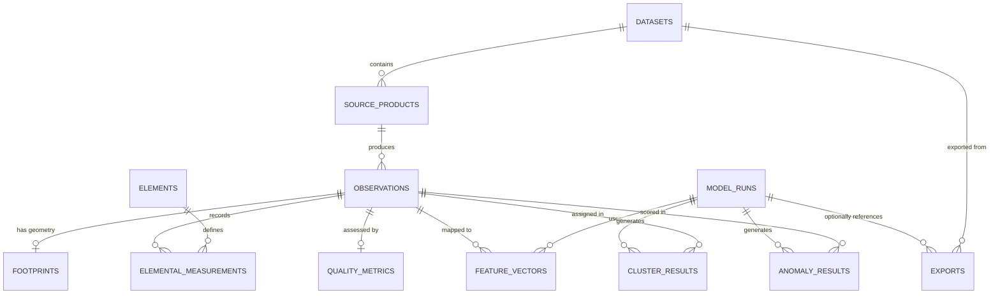

# Database Design

| Field | Value |
| --- | --- |
| **Document** | `docs/DATABASE_DESIGN.md` |
| **Version** | `0.1.0` |
| **Status** | `Proposed — Planning Phase` |
| **Owner** | `[Member 4 Name Placeholder]` |
| **Last updated** | `2026-11-24` |
| **Reviewers** | `[Member 1 Name Placeholder]`, `[Member 2 Name Placeholder]` |

---

> [!NOTE]
> This schema is **Proposed** for SQLite (`lunaspectra.db`) managed via SQLAlchemy and Alembic migrations. Final column types will be confirmed once Chandrayaan-2 PDS4 product schemas are verified in Phase 2.

---

## 1. Core Design Invariants

1. **Strict Separation of Measurements and ML Outputs:** Raw/validated scientific measurements (`elemental_measurements`, `quality_metrics`) are stored separately from derived ML artifacts (`feature_vectors`, `cluster_results`, `anomaly_results`).
2. **Model-Run Traceability:** Every cluster assignment and anomaly score references a row in `model_runs`, which captures algorithm, configuration, feature list, preprocessing version, random seed, and creation timestamp.
3. **Full Archive Provenance:** Every `observation` references its `source_product`, which references a `dataset` and `provenance_uri`.
4. **Explicit Units:** `elements` and `elemental_measurements` record explicit physical units (`wt%`, ratio, etc., verified in Phase 2).
5. **Null Semantics:** `NULL` strictly means unmeasured or unavailable—never `0`.
6. **Coordinate & Longitude Convention:**
   - `center_latitude` constrained by `CHECK (center_latitude >= -90.0 AND center_latitude <= 90.0)`
   - `center_longitude` uses one canonical convention: **East-positive `[-180.0, 180.0]`**, constrained by `CHECK (center_longitude >= -180.0 AND center_longitude <= 180.0)`.
7. **Mission vs. Synthetic Isolation:** `data_origin` (`mission` | `synthetic`) is enforced on `datasets`, `observations`, and `model_runs`.

---

## 2. Entity-Relationship Diagram (Proposed)

---

## 3. Normalized Table Specifications (Proposed)

### 3.1 `datasets`
Stores top-level dataset registry entries and attribution rules.
- **Key Columns:** `dataset_id` (PK), `name`, `instrument` (`CLASS` | `XSM` | `COMBINED`), `processing_level`, `version`, `data_origin` (`mission` | `synthetic`), `source_archive`, `attribution_text`, `license_notes`, `created_at`.

### 3.2 `source_products`
Tracks each downloaded ISSDC/PDS4 file or synthetic bundle.
- **Key Columns:** `source_product_id` (PK), `dataset_id` (FK -> `datasets.dataset_id`), `product_version`, `file_name`, `checksum_sha256`, `provenance_uri`, `ingestion_timestamp`.

### 3.3 `observations`
Core geospatial and temporal measurement entity.
- **Key Columns:** `observation_id` (PK), `source_product_id` (FK -> `source_products.source_product_id`), `dataset_id` (FK -> `datasets.dataset_id`), `acquisition_start_time` (nullable), `acquisition_end_time` (nullable), `center_latitude` (`CHECK [-90, 90]`), `center_longitude` (`CHECK [-180, 180]`), `solar_observation_reference` (nullable), `data_origin`, `created_at`.

### 3.4 `footprints`
Stores spatial footprint geometry separately from scalar observation attributes.
- **Key Columns:** `footprint_id` (PK), `observation_id` (UNIQUE FK -> `observations.observation_id`), `geometry_type` (`Point` | `Polygon`), `geojson_text`, `wkt_text`, `area_km2` (nullable), `coordinate_convention` (`lon_east_180`).

### 3.5 `elements`
Catalog of tracked chemical elements and their canonical units.
- **Key Columns:** `element_id` (PK), `symbol` (`Mg`, `Al`, `Si`, `Ca`, `Fe`, etc., UNIQUE), `name`, `atomic_number`, `default_unit`, `unit_verified` (boolean).

### 3.6 `elemental_measurements`
Normalized per-element values and uncertainties for each observation.
- **Key Columns:** `measurement_id` (PK), `observation_id` (FK -> `observations.observation_id`), `element_id` (FK -> `elements.element_id`), `abundance_value` (nullable float; `NULL` = unmeasured), `uncertainty_value` (nullable float, `>= 0`), `unit` (explicit non-null string), `is_below_detection` (boolean).
- **Unique Constraint:** `(observation_id, element_id)`.

### 3.7 `quality_metrics`
Preserves source quality flags and reliability scores without mutating measurements.
- **Key Columns:** `quality_id` (PK), `observation_id` (UNIQUE FK -> `observations.observation_id`), `raw_quality_flag`, `normalized_quality_flag` (`GOOD` | `CAUTION` | `POOR` | `UNVERIFIED`), `quality_score` (`[0.0, 1.0]`, nullable), `signal_notes`.

### 3.8 `model_runs`
Immutable metadata log for every ML clustering or anomaly-detection run.
- **Key Columns:** `model_run_id` (PK), `dataset_id` (FK -> `datasets.dataset_id`), `data_origin`, `task_type` (`clustering` | `anomaly`), `algorithm`, `hyperparameters_json`, `feature_columns_json`, `preprocessing_version`, `random_seed`, `evaluation_metrics_json`, `artifact_path`, `created_at`.

### 3.9 `feature_vectors`
Stores engineered feature inputs (e.g., guarded ratios and scaled values) linked to a specific preprocessing/model context.
- **Key Columns:** `vector_id` (PK), `observation_id` (FK -> `observations.observation_id`), `model_run_id` (FK -> `model_runs.model_run_id`), `raw_features_json`, `scaled_features_json`, `mg_si_ratio` (nullable), `al_si_ratio` (nullable), `fe_si_ratio` (nullable).

### 3.10 `cluster_results`
Derived clustering assignments separated from measurement tables.
- **Key Columns:** `cluster_result_id` (PK), `model_run_id` (FK -> `model_runs.model_run_id`), `observation_id` (FK -> `observations.observation_id`), `cluster_label` (int; `-1` for DBSCAN noise), `distance_to_centroid` (nullable float), `pca_x` (nullable float), `pca_y` (nullable float).
- **Unique Constraint:** `(model_run_id, observation_id)`.

### 3.11 `anomaly_results`
Derived anomaly scores separated from measurement tables.
- **Key Columns:** `anomaly_result_id` (PK), `model_run_id` (FK -> `model_runs.model_run_id`), `observation_id` (FK -> `observations.observation_id`), `anomaly_score` (float), `is_flagged` (boolean), `rank_order` (int), `quality_screened` (boolean).
- **Unique Constraint:** `(model_run_id, observation_id)`.

### 3.12 `exports`
Audit log for user-triggered JSON/CSV/GeoJSON exports.
- **Key Columns:** `export_id` (PK), `dataset_id` (FK -> `datasets.dataset_id`), `model_run_id` (nullable FK -> `model_runs.model_run_id`), `export_format` (`json` | `csv` | `geojson`), `filter_params_json`, `record_count`, `data_origin`, `created_at`.

---

## 4. Related Documents

- [Data Dictionary](DATA_DICTIONARY.md)
- [Data Pipeline](DATA_PIPELINE.md)
- [API Specification](API_SPECIFICATION.md)
- [ML Methodology](ML_METHODOLOGY.md)
