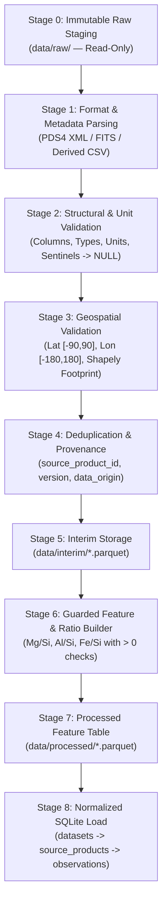

# Data Pipeline

| Field | Value |
| --- | --- |
| **Document** | `docs/DATA_PIPELINE.md` |
| **Version** | `0.1.0` |
| **Status** | `Proposed — Planning Phase` |
| **Owner** | `[Member 1 Name Placeholder]` |
| **Last updated** | `2026-11-24` |
| **Reviewers** | `[Member 2 Name Placeholder]`, `[Member 4 Name Placeholder]` |

---

> [!NOTE]
> This pipeline specification is **Proposed**. Implementation scripts will be added under `scripts/` and `backend/` after Phase 2 PDS4 product verification.

---

## 1. Pipeline Overview

The LunaSpectra data pipeline transforms verified raw Chandrayaan-2 derived/processed products (or isolated synthetic development fixtures) into validated Parquet feature tables and normalized SQLite database records without mutating source files.

---

## 2. Proposed Data-Processing Pipeline

---

## 3. Stage-by-Stage Responsibilities

### Stage 0: Immutable Raw Staging
- Downloaded ISSDC products are placed manually or via verified scripts into `data/raw/<dataset_id>/`.
- Raw files are **never edited in place** and remain git-ignored.

### Stage 1: Format and Metadata Parsing
- Parse PDS4 labels (`.xml`) or FITS headers (via `astropy.io.fits`) or structured tabular files (via `pandas`).
- Extract dataset metadata (`dataset_id`, `processing_level`, `product_version`, `provenance_uri`) and acquisition timestamps.

### Stage 2: Structural and Unit Validation
- Verify required columns and expected physical units (documented in Phase 2).
- Convert archive sentinel values (e.g., `-999`, `-9999`, `"NA"`) strictly to `NULL` / `NaN`.
- **Never coerce missing elemental values to `0.0`.**

### Stage 3: Geospatial Validation and Normalization
- Validate `center_latitude` in `[-90.0, 90.0]`.
- Normalize longitudes from `[0.0, 360.0)` to canonical `[-180.0, 180.0]` when required, checking antimeridian edge cases before building footprints.
- Validate polygon/point footprints using `shapely` (`is_valid`, closed ring orientation) and reject or quarantine malformed geometries with explicit error logs.

### Stage 4: Deduplication and Provenance Tagging
- Detect duplicate `source_product_id` + observation coordinate/timestamp tuples.
- Attach `data_origin` (`mission` or `synthetic`) and `ingestion_timestamp`.
- Enforce strict separation: a pipeline run must never merge `synthetic` rows into a `mission` output table.

### Stage 5 & 6: Interim Persistence and Guarded Feature Engineering
- Persist cleaned observational rows to `data/interim/`.
- Compute elemental ratios (`Mg/Si`, `Al/Si`, `Fe/Si`) **only when**:
  1. Both numerator and denominator are non-null and finite.
  2. Both share compatible physical abundance units.
  3. The denominator (`Si`) exceeds a strictly positive safety threshold (`si_abundance > epsilon`) to prevent division-by-zero or near-zero numerical blow-up.
- Preserve original uncertainties and quality flags alongside derived ratios.

### Stage 7 & 8: Processed Parquet and SQLite Load
- Write the analysis-ready feature table to `data/processed/` via PyArrow (`parquet`).
- Load normalized tables into SQLite (`datasets`, `source_products`, `observations`, `footprints`, `elements`, `elemental_measurements`, `quality_metrics`) using SQLAlchemy transactions.

---

## 4. Planned Validation & Quarantine Policy

Records failing hard invariants (out-of-range coordinates, invalid geometries, unknown `data_origin`, negative uncertainties) are written to a local quarantine log with failure reasons rather than silently dropped or silently repaired.

---

## 5. Related Documents

- [Dataset Guide](DATASET_GUIDE.md)
- [Data Dictionary](DATA_DICTIONARY.md)
- [Database Design](DATABASE_DESIGN.md)
- [Testing Strategy](TESTING_STRATEGY.md)
