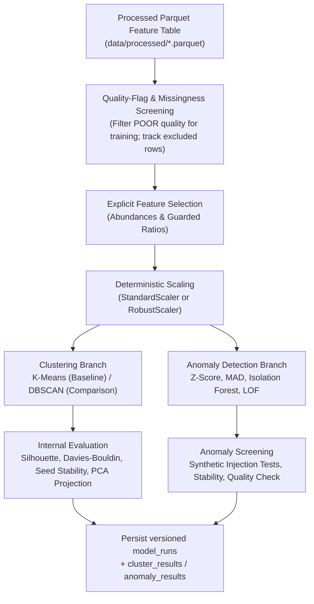

# Machine-Learning Methodology

| Field | Value |
| --- | --- |
| **Document** | `docs/ML_METHODOLOGY.md` |
| **Version** | `0.1.0` |
| **Status** | `Proposed — Planning Phase` |
| **Owner** | `[Member 2 Name Placeholder]` |
| **Last updated** | `2026-11-24` |
| **Reviewers** | `[Member 1 Name Placeholder]`, `[Faculty Guide Name Placeholder]` |

---

> [!IMPORTANT]
> All algorithms, feature selections, and evaluation steps described below are **Proposed**. No model training has been executed yet, and no performance metrics, cluster counts, or anomaly rates are claimed prior to Phase 4 experiments.

---

## 1. Scientific Framing for Machine Learning

In planetary X-ray remote sensing, ground-truth mineralogical labels rarely exist across every orbital footprint. Therefore, LunaSpectra frames its ML tasks strictly as **exploratory unsupervised pattern discovery and quality-aware outlier screening**—not supervised mineral classification.

---

## 2. Proposed Machine-Learning Workflow

---

## 3. Feature Engineering & Preprocessing

### 3.1 Candidate Features (Subject to Phase 2 Dataset Verification)

- Major elemental abundances (where verified in selected product): `Mg`, `Al`, `Si`, `Ca`, `Fe`
- Guarded elemental ratios: `Mg/Si`, `Al/Si`, `Fe/Si` (computed only with positive, compatible denominators)
- Contextual / uncertainty metadata (used for weighting, filtering, or post-hoc interpretation rather than naive clustering inputs):
  - Per-element measurement uncertainties (`mg_uncertainty`, `al_uncertainty`, etc.)
  - Signal-quality indicators (`quality_flag`, `quality_score`)

### 3.2 Preprocessing Rules

1. **Duplicate Removal:** Ensure unique `observation_id` rows before vector construction.
2. **Coordinate & Unit Checks:** Confirm identical measurement units across all features.
3. **Missing-Value Strategy:** Document missingness per element; never fill unmeasured elements with `0`. Either evaluate complete-case subsets for core elements or apply explicitly logged, bounded imputation strategies only if justified and sensitivity-tested.
4. **Quality-Flag Filtering:** Train baseline models on quality-screened subsets (e.g., `GOOD` / verified quality) and compare against unfiltered runs to detect noise-driven clusters or anomalies.
5. **Uncertainty Preservation:** Keep uncertainties visible alongside cluster assignments and anomaly scores.
6. **Scaling:** Compare `StandardScaler` vs. `RobustScaler` (which reduces sensitivity to extreme outliers) and record the chosen scaler in `model_runs.preprocessing_version`.
7. **Provenance Tracking:** Log exact dataset version, `data_origin`, feature list, and random seed in `model_runs`.

---

## 4. Clustering Methodology

| Method | Role | Key Design Notes |
| --- | --- | --- |
| **K-Means** | Initial baseline | Simple, interpretable centroid profiles in feature space; evaluate candidate `k` values systematically. |
| **DBSCAN** | Optional density-based comparison | Explores non-spherical groupings and explicit noise points (`-1`) without forcing every point into a cluster. |
| **PCA** | Visualization & interpretation | 2D/3D projection solely for exploratory scatter plots and feature-loading inspection, not as proof of physical classes. |

### 4.1 Clustering Evaluation Metrics

Because clustering is unsupervised, evaluation relies on internal structural metrics and robustness checks—**never** fabricated classification accuracy:

- **Silhouette Score** (cohesion vs. separation)
- **Davies–Bouldin Index** (cluster compactness vs. centroid distance)
- **Stability Analysis:** Measure assignment consistency (e.g., Adjusted Rand Index across random seeds and between `StandardScaler` and `RobustScaler`).

### 4.2 Interpretation Guardrail

> An ML cluster represents **observations with similar measured feature vectors** under a specific preprocessing and `model_run_id`. It is **not** automatically a geological formation, rock type, or mineral class.

---

## 5. Anomaly Detection Methodology

| Method | Role | Key Design Notes |
| --- | --- | --- |
| **Z-Score** | Univariate statistical baseline | Flags extreme single-element or single-ratio deviations under approximate normality assumptions. |
| **Median Absolute Deviation (MAD)** | Robust univariate baseline | Uses median and MAD to resist distortion from existing outliers. |
| **Isolation Forest** | Primary multivariate ML method | Isolates observations with unusual combinations across multiple elemental features and ratios. |
| **Local Outlier Factor (LOF)** | Optional density comparison | Compares local neighborhood density against Isolation Forest rankings. |

### 5.1 Quality-Aware Verification & Evaluation

1. **Quality Screening First:** Always inspect `quality_flag`, `quality_score`, and uncertainties before treating a high anomaly score as notable.
2. **Controlled Synthetic Anomaly Injection:** In test suites (using strictly `synthetic` fixtures), inject known compositional outliers (e.g., shifted `Mg/Si` or elevated `Fe`) to verify that detectors rank injected outliers appropriately.
3. **Stability Analysis:** Compare top-ranked anomalies across seeds and `StandardScaler` vs. `RobustScaler`.
4. **No Supervised Accuracy Claims:** Without verified planetary ground-truth anomaly labels, precision/recall/F1 against real mission data must **not** be claimed.

### 5.2 Interpretation Guardrail

> A flagged anomaly means **statistically or algorithmically unusual relative to the model run's feature distribution**. It may reflect unusual surface composition, measurement noise, weak solar signal, calibration artifacts, missing context, or a processing error.

---

## 6. Related Documents

- [Data Dictionary](DATA_DICTIONARY.md)
- [Database Design](DATABASE_DESIGN.md)
- [Ethics and Limitations](ETHICS_AND_LIMITATIONS.md)
- [Testing Strategy](TESTING_STRATEGY.md)
