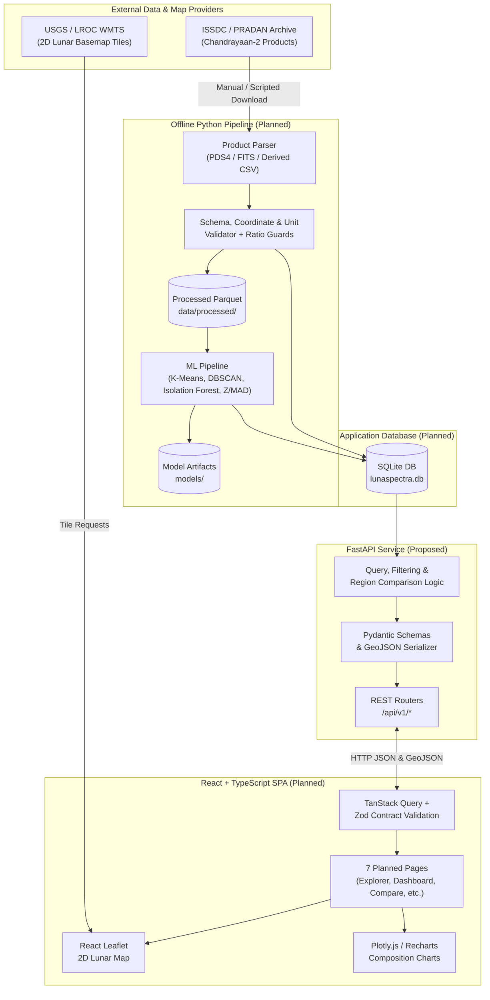
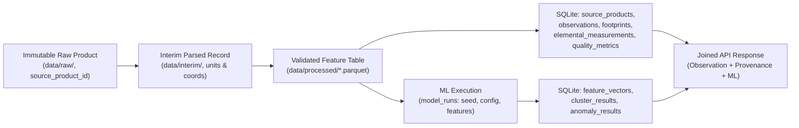
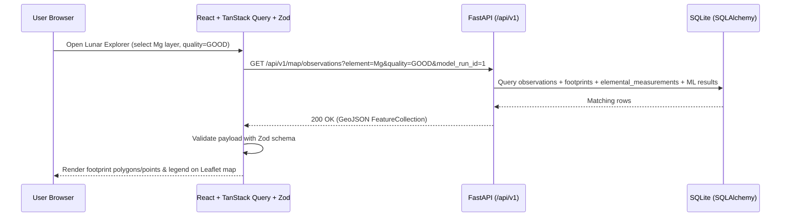
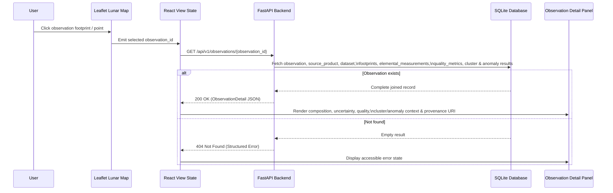

# System Architecture

| Field | Value |
| --- | --- |
| **Document** | `docs/SYSTEM_ARCHITECTURE.md` |
| **Version** | `0.1.0` |
| **Status** | `Proposed — Planning Phase` |
| **Owner** | `[Member 4 Name Placeholder]` |
| **Last updated** | `2026-11-24` |
| **Reviewers** | `[All Team Members Placeholder]`, `[Faculty Guide Name Placeholder]` |

---

> [!NOTE]
> All components, services, and data flows documented here are **Proposed** architectural specifications for the LunaSpectra MVP. Implementation begins in Phases 1–5.

---

## 1. Architectural Overview

LunaSpectra separates **heavyweight scientific data ingestion and ML execution** (offline Python pipeline) from **interactive querying and geospatial visualization** (FastAPI backend + React/TypeScript frontend). This separation keeps the web API fast and predictable while preserving strict scientific lineage from raw ISSDC files through processed Parquet tables and versioned `model_runs`.

---

## 2. High-Level System Architecture (Proposed)

---

## 3. Scientific Data Lineage

Maintaining end-to-end traceability prevents analytical results from being detached from their physical measurement context.

Key lineage invariants:
- Source measurements (`elemental_measurements`) and derived ML outputs (`cluster_results`, `anomaly_results`) are stored in **separate normalized tables**.
- Every derived ML result links back to a specific `model_run_id`.
- `data_origin` (`mission` or `synthetic`) travels from ingestion to the UI.

---

## 4. Frontend and Backend Interaction

---

## 5. Request Lifecycle: Selecting an Observation on the Map

---

## 6. Architectural Trade-offs (2-Credit Scope)

| Decision | Choice for MVP | Rationale | Future Scaling Path |
| --- | --- | --- | --- |
| **Database** | SQLite + local Parquet | Zero-ops setup for 4-student local development; fast analytical reads via PyArrow. | PostgreSQL + PostGIS (Phase 8) |
| **ML Execution** | Offline Python batch scripts | Avoids slow synchronous training inside API requests; ensures reproducible `model_runs`. | Background worker / task queue if needed |
| **Map Projection** | 2D Leaflet lunar basemap | Lightweight, reliable, supports GeoJSON footprints and custom tile layers. | CesiumJS 3D lunar globe (Phase 8) |
| **Spectral Input** | Approach A derived abundances | Fits 2-credit scope without claiming unverified spectral response modelling. | Approach B raw CLASS+XSM (Phase 8) |

---

## 7. Related Documents

- [Data Pipeline](DATA_PIPELINE.md)
- [Database Design](DATABASE_DESIGN.md)
- [API Specification](API_SPECIFICATION.md)
- [Frontend Specification](FRONTEND_SPECIFICATION.md)
- [ML Methodology](ML_METHODOLOGY.md)
