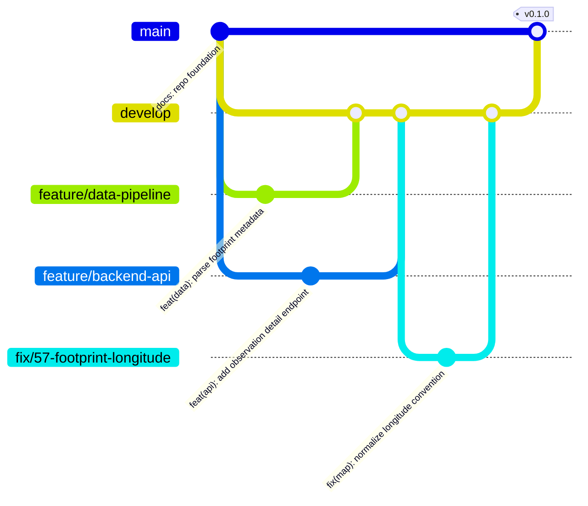

# Team and Branch Workflow

| Field | Value |
| --- | --- |
| **Document** | `docs/TEAM_WORKFLOW.md` |
| **Version** | `0.1.0` |
| **Status** | `Active — Repository Governance` |
| **Owner** | `[Member 4 Name Placeholder]` |
| **Last updated** | `2026-11-24` |
| **Reviewers** | `[All Team Members Placeholder]` |

---

## 1. Team Responsibility Split

| Role | Primary Ownership | Placeholder |
| --- | --- | --- |
| **Member 1** | Data acquisition, PDS4/FITS parsing, and preprocessing | `[Member 1 Name Placeholder]` (`[Student ID]`) |
| **Member 2** | Machine learning, evaluation, and scientific analysis | `[Member 2 Name Placeholder]` (`[Student ID]`) |
| **Member 3** | Frontend, interactive lunar mapping, and visualization | `[Member 3 Name Placeholder]` (`[Student ID]`) |
| **Member 4** | Backend, database, integration, and repository maintenance | `[Member 4 Name Placeholder]` (`[Student ID]`) |

---

## 2. Branching Architecture

### 2.1 Long-Lived Branches
- `main`: Stable milestone and release branch (academic submissions and tagged releases).
- `develop`: Shared integration branch where reviewed feature work converges.

### 2.2 Initial Parallel Foundation Branches
- `feature/data-pipeline` (Member 1)
- `feature/ml-analysis` (Member 2)
- `feature/frontend-map` (Member 3)
- `feature/backend-api` (Member 4)

### 2.3 Issue-Linked Branches (Preferred After Foundation)
- `feature/42-observation-endpoint`
- `fix/57-footprint-longitude`
- `docs/18-dataset-guide`
- `test/63-api-contract`

---

## 3. Git Branch Workflow Diagram

---

## 4. Mandatory Workflow Rules

1. **No direct pushes to `main`.**
2. **Prefer no direct pushes to `develop`.**
3. **Create pull requests into `develop`** for all feature, bugfix, test, and docs work.
4. **Require at least one teammate review** before merging a pull request.
5. **Keep pull requests focused** on a single issue or small coherent change.
6. **Use Conventional Commit messages** across all branches.
7. **Update documentation with implementation changes** (schemas, endpoints, and caveats stay synchronized).
8. **Agree on schemas and API contracts before parallel development** (cross-review [DATA_DICTIONARY.md](DATA_DICTIONARY.md) and [API_SPECIFICATION.md](API_SPECIFICATION.md)).
9. **Merge `develop` into a feature branch** when integration updates are needed during active work.
10. **Merge `develop` into `main` only for reviewed milestones.**
11. **Tag releases using semantic versioning** (e.g., `v0.1.0`, `v0.2.0`, `v1.0.0`).
12. **Never commit secrets or downloaded scientific products** (`data/raw/`, `.env`, tokens, model binaries).

---

## 5. Conventional Commit Standard

Format: `<type>(<scope>): <imperative summary>`

Approved examples:

- `feat(frontend): add lunar layer selector`
- `feat(api): add observation detail endpoint`
- `feat(data): parse footprint metadata`
- `feat(ml): add robust anomaly baseline`
- `fix(map): normalize longitude convention`
- `docs(readme): clarify dataset limitations`
- `test(api): add observation schema tests`
- `chore(repo): configure pull request template`

---

## 6. Related Documents

- [Contributing Guide](../CONTRIBUTING.md)
- [Roadmap](ROADMAP.md)
- [Testing Strategy](TESTING_STRATEGY.md)
- [Decision Log](DECISION_LOG.md)
